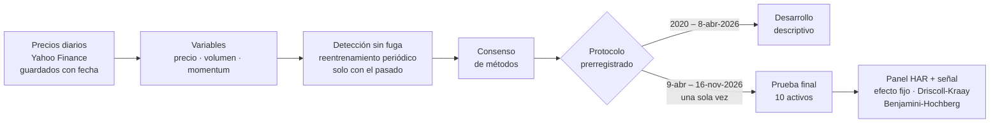
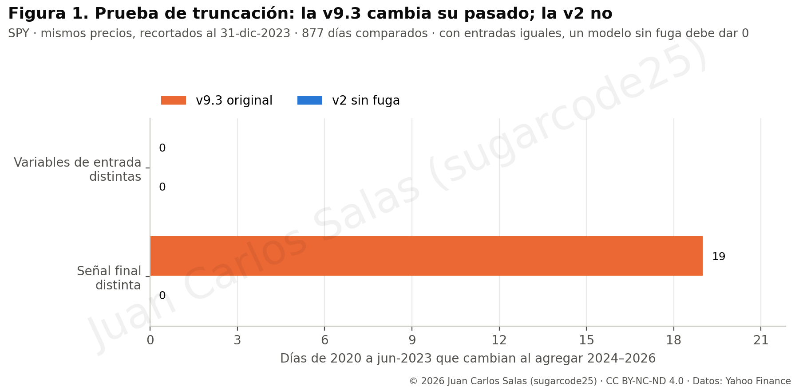
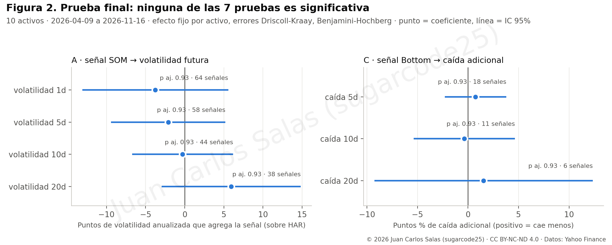
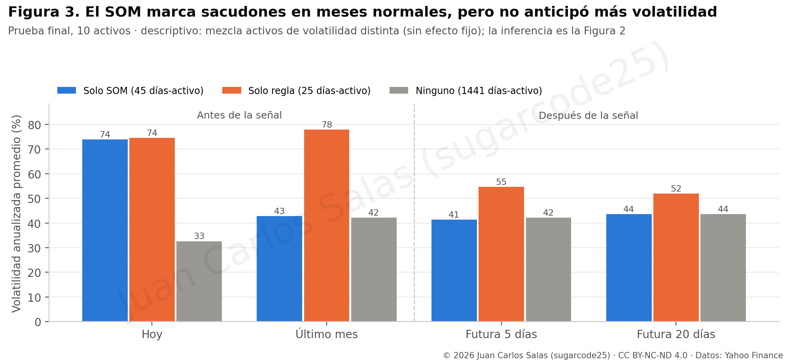
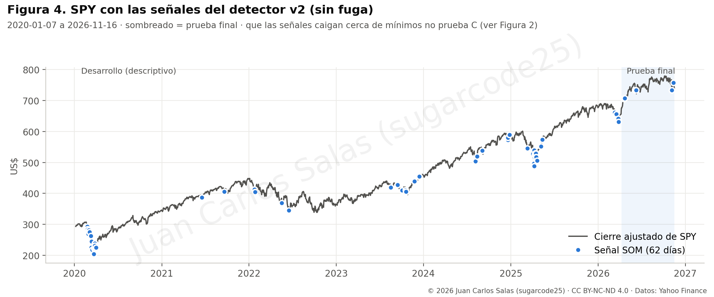

# Detector de anomalías con SOM — v2: auditoría y prueba fuera de muestra

> **Qué es este repositorio.** Es la segunda versión de un detector de anomalías de mercado basado en Mapas Auto-Organizados (SOM). La v1 (v9.3, congelada el 8-abr-2026) tenía una **fuga de información**: usaba datos del futuro para calificar el pasado. Esta v2 la corrige, la demuestra con una prueba reproducible y somete el modelo a una **prueba fuera de muestra prerregistrada, corrida una sola vez**. El resultado fue **no concluyente**, y aquí se reporta tal cual.
>
> La v1 queda archivada en [financial-anomaly-detector](https://github.com/sugarcode25/financial-anomaly-detector), con sus errores documentados en su `ISSUES.md`.

---

## Abstract (English)

This repository audits and rebuilds a Self-Organizing Map (SOM) anomaly detector for equity and cross-asset markets. The original version (v9.3) suffered from look-ahead bias: its model components and thresholds were fit on the full sample, so adding 2024–2026 data changed which 2020–2023 days were flagged (19 of 877 days on SPY). Version 2 retrains periodically using only past data and calibrates thresholds on days the calibration model never saw; the same truncation test yields 0 changes. We then pre-registered two hypotheses and tested them once, out of sample (9 Apr – 16 Nov 2026, 10 assets): (A) a SOM signal adds information about future realized volatility beyond a HAR benchmark, and (C) "bottom" signals are followed by smaller additional drawdowns. Using a panel regression with asset fixed effects, Driscoll-Kraay standard errors and a Benjamini-Hochberg correction over 7 tests, **none was significant (all adjusted p = 0.93)**. Confidence intervals are wide and include both zero and the effect observed in development, so the result is inconclusive rather than a refutation. Descriptively, the SOM flags sharp moves in otherwise calm months, but in the test period those moves were not followed by higher volatility.

---

## Resumen

| Pregunta | Respuesta | Evidencia (figura · celda del notebook) |
|---|---|---|
| ¿La v1 usaba el futuro? | **Sí.** Al agregar 2024–2026, cambian 19 de 877 días de 2020 a jun-2023 en SPY. | Figura 1 · celda 7 |
| ¿La v2 lo corrige? | **Sí.** La misma prueba da 0 cambios. | Figura 1 · celda 7 |
| A: ¿el SOM anticipa volatilidad más allá del HAR? | **No concluyente.** Coeficientes de −3.8 a +5.9 puntos; p ajustado 0.93 en las cuatro ventanas. | Figura 2 · celda 19 |
| C: ¿tras una señal de piso la caída es menor? | **No concluyente.** p ajustado 0.93 en las tres ventanas. | Figura 2 · celda 19 |
| ¿Qué marca el SOM? | Movimientos fuertes en meses normales. En la prueba, después de esos días la volatilidad fue la de un día cualquiera. | Figura 3 · celda 20 |

---

## Origen: qué se construyó y qué se corrigió

Es un **proyecto personal de investigación**, no un encargo académico. Nació de una pregunta propia (¿puede un modelo no supervisado reconocer estados inusuales del mercado?) y avanzó con el ciclo de investigar, probar, validar y corregir: nueve versiones con pruebas en distintos activos y, en esta v2, una auditoría de su propio método.

| Etapa | Contenido |
|---|---|
| **Prototipo** | Detección de anomalías con SOM sobre datos sintéticos de opciones. |
| **v1 (versiones 1 a 9.3)** | Adaptación a precios reales; variables de precio, volumen y momentum; reducción de dimensionalidad; varios métodos de detección combinados por consenso; clasificación por tipo de señal; pruebas en 10 activos de distintos perfiles. |
| **Corregido en esta v2** | Fuga de información (componentes del modelo y umbrales ajustados con todo el periodo); datos previos al listado de SOFI, GRAB y JOBY, que eran de la SPAC; un error de signo en la clasificación de señales; ausencia de una línea base y de una prueba fuera de muestra. |

---

## Arquitectura

**Detección sin fuga, en una frase:** en cada fecha de reentrenamiento, todos los componentes del modelo (reducción de dimensionalidad, mapas, umbrales y reglas de clasificación) se ajustan solo con días anteriores, y ese modelo califica el tramo siguiente. Los umbrales se calibran sobre días que el modelo de calibración no vio, para que estén en la misma escala que los días nuevos.

---

## Protocolo

El protocolo se fijó **antes** de mirar los datos de prueba; sus dos enmiendas se registraron antes de ver resultados.

- **Desarrollo:** 7-ene-2020 a 8-abr-2026. Son los años con los que se ajustaron las 9 versiones de la v1, así que sus resultados son **solo descriptivos**.
- **Prueba:** desde el 9-abr-2026, el primer día que ninguna versión vio. Se corrió **una sola vez** (16-nov-2026), con un registro con fecha y hora.
- **Activos (10):** SPY, QQQ, AMD, LLY, MARA, EWZ, GLD, SOFI, GRAB y JOBY. SOFI, GRAB y JOBY empiezan en su fecha de listado (1-jun-2021, 2-dic-2021 y 11-ago-2021, verificadas en SEC EDGAR).
- **Hipótesis A:** la señal del SOM agrega información sobre la volatilidad realizada de los 1, 5, 10 y 20 días siguientes, más allá del modelo HAR (volatilidad de hoy, de la última semana y del último mes; Corsi, 2009).
- **Hipótesis C:** tras una señal de piso ("Bottom"), la caída adicional a 5, 10 y 20 días es menor que la esperada para un día con la misma volatilidad reciente.
- **Estimación:** regresión en panel con efecto fijo por activo y errores Driscoll-Kraay (Driscoll y Kraay, 1998), con rezagos = ventana + 5.
- **Comparaciones múltiples:** corrección de Benjamini-Hochberg (1995) sobre las 7 pruebas.
- **Línea base:** una regla simple de volatilidad con la **misma frecuencia de alertas** que el SOM, calculada sin usar el futuro.

---

## Resultados

### 1. La fuga de información y su corrección

Se corre el modelo dos veces con **los mismos precios**: una vez completos y otra recortados al 31-dic-2023. Un modelo sin fuga debe calificar igual los días de 2020 a junio de 2023 en las dos corridas, porque esos días no dependen de lo que pasó después.

- **Variables de entrada:** idénticas en las dos corridas, en las dos versiones.
- **Señal final:** en la v9.3 cambian 19 de 877 días; en la v2, 0.

Como las entradas no cambian, la diferencia de la v9.3 solo puede venir de que el modelo aprendió con datos del futuro.

### 2. Desarrollo (SPY, descriptivo)

- El SOM marcó el 3.5% de los días y la regla simple el 5.7%; en episodios (señales a 5 días hábiles o menos cuentan como uno), 20 contra 5.
- Con el HAR como control, la señal del SOM sumó cerca de +5 puntos de volatilidad anualizada a 5 días (p = 0.049, sin corregir por comparaciones múltiples), con el mismo signo en las cuatro ventanas. Agregar el VIX no cambió el resultado.
- Hipótesis C: tras una señal Bottom la caída media a 20 días fue −6.6% contra −2.7% del resto, pero a igual volatilidad la diferencia se reduce a −1.6 puntos y no es significativa. **La caída mayor se explicaba por la volatilidad, no por la señal.**

Estos números motivaron la prueba final; no la reemplazan.

### 3. Prueba final (10 activos, 9-abr a 16-nov-2026)

| Prueba | Señales | Coef. | IC 95% | p | p ajustado (BH) | Conclusión |
|---|---:|---:|---|---:|---:|---|
| A · volatilidad 1d | 64 | −3.76 | [−13.09, +5.56] | 0.429 | 0.931 | no concluyente |
| A · volatilidad 5d | 58 | −2.11 | [−9.43, +5.20] | 0.571 | 0.931 | no concluyente |
| A · volatilidad 10d | 44 | −0.28 | [−6.73, +6.17] | 0.931 | 0.931 | no concluyente |
| A · volatilidad 20d | 38 | +5.92 | [−2.97, +14.82] | 0.192 | 0.931 | no concluyente |
| C · caída 5d | 18 | +0.74 | [−2.31, +3.78] | 0.634 | 0.931 | no concluyente |
| C · caída 10d | 11 | −0.37 | [−5.37, +4.64] | 0.886 | 0.931 | no concluyente |
| C · caída 20d | 6 | +1.54 | [−9.26, +12.34] | 0.780 | 0.931 | no concluyente (menos de 10 señales) |

*A: puntos de volatilidad anualizada que agrega una señal SOM sobre el HAR. C: puntos porcentuales de caída adicional; positivo = cae menos.*

**Cómo leerlo.** "No concluyente" no es "no funciona". Los intervalos son muy anchos: el de A a 5 días incluye tanto el 0 (el SOM no aporta) como el +5 observado en desarrollo. Con 154 sesiones, la prueba no tiene poder para distinguir entre las dos historias. Además, el signo cambia entre ventanas, cuando un efecto real debería tener el mismo signo en todas.

**Robustez con el VIX (solo SPY, descriptivo):** con 5 a 7 señales, ningún coeficiente es significativo.

### 4. Qué ve el SOM (descriptivo)

En la prueba final, los días que marcó **solo el SOM** tuvieron un movimiento fuerte (volatilidad del día 73.9 contra 32.6 del resto) dentro de un mes normal (42.8 contra 42.2). Después, la volatilidad fue la de un día cualquiera (5 días: 41.3 contra 42.2). En desarrollo, en cambio, esos sacudones sí precedían más volatilidad: **ese patrón no se repitió fuera de muestra.**

La regla simple marca crisis ya en curso (volatilidad del último mes: 77.9), y después de sus días la volatilidad siguió alta (5 días: 54.6).

*Advertencia:* esta tabla mezcla activos de volatilidad muy distinta y no tiene efecto fijo; la inferencia es la de la Figura 2.

A simple vista, las señales parecen concentrarse cerca de los mínimos (marzo de 2020, 2022, abril de 2025). Esa impresión fue el origen de la hipótesis C, y la prueba muestra por qué no basta: los mínimos son también los días más volátiles, y a igual volatilidad la señal no agrega información.

---

## Limitaciones

1. **Poder estadístico bajo.** El periodo de prueba tiene 154 sesiones; los intervalos son demasiado anchos para confirmar o descartar un efecto del tamaño visto en desarrollo.
2. **Señales del final sin ventana completa.** Parte de las señales cayó en las últimas semanas y no tiene 20 días de futuro (SOM: 64 señales a 1 día y 38 a 20 días; Bottom: 18 a 5 días y 6 a 20 días). No se corrige volviendo a correr la prueba, porque eso la usaría dos veces.
3. **Fechas de corte.** SPY termina el 16-nov-2026 y los otros nueve activos el 13-nov-2026 (descargas en fechas distintas); afecta una sesión.
4. **Datos de un proveedor gratuito.** Los precios ajustados de Yahoo Finance pueden cambiar retroactivamente; por eso cada descarga se guarda con su fecha y todas las corridas usan la misma copia.
5. **La regla de línea base es una sola.** Otras líneas base (por ejemplo, GARCH) podrían dar comparaciones distintas.

---

## Próximos pasos

El resultado no concluyente se debe sobre todo a la poca muestra. La forma honesta de resolverlo es una **validación hacia adelante**: congelar el modelo y evaluarlo, con el mismo protocolo y una sola vez, sobre datos posteriores al 16-nov-2026, cuando haya suficientes sesiones para que los intervalos sean informativos. Volver a correr la prueba actual con más datos no sirve: la usaría dos veces.

---

## Reproducibilidad

- **Código:** el notebook (26 celdas en orden) **no se publica**. Cada número de este README sale de una de sus celdas, indicada en el Resumen, y el autor puede mostrarlo en una revisión técnica.
- **Versiones:** las versiones exactas de Python y de cada librería quedan fijadas junto al notebook.
- **Datos:** no se incluyen. La celda 3 los descarga de Yahoo Finance una sola vez y los guarda con fecha en Google Drive; las corridas siguientes leen esa copia.
- **Semillas:** fijas, para que cada corrida dé el mismo resultado.
- **Registro de la prueba final:** archivo con fecha y hora de la única ejecución (16-nov-2026).

---

## Referencias

Benjamini, Y., & Hochberg, Y. (1995). Controlling the false discovery rate: A practical and powerful approach to multiple testing. *Journal of the Royal Statistical Society: Series B (Methodological), 57*(1), 289–300. https://doi.org/10.1111/j.2517-6161.1995.tb02031.x

Corsi, F. (2009). A simple approximate long-memory model of realized volatility. *Journal of Financial Econometrics, 7*(2), 174–196. https://doi.org/10.1093/jjfinec/nbp001

Driscoll, J. C., & Kraay, A. C. (1998). Consistent covariance matrix estimation with spatially dependent panel data. *The Review of Economics and Statistics, 80*(4), 549–560. https://doi.org/10.1162/003465398557825

Kohonen, T. (1990). The self-organizing map. *Proceedings of the IEEE, 78*(9), 1464–1480. https://doi.org/10.1109/5.58325

Newey, W. K., & West, K. D. (1987). A simple, positive semi-definite, heteroskedasticity and autocorrelation consistent covariance matrix. *Econometrica, 55*(3), 703–708. https://doi.org/10.2307/1913610

Vettigli, G. (2018). *MiniSom: Minimalistic and NumPy-based implementation of the Self Organizing Map* [Software]. GitHub. https://github.com/JustGlowing/minisom

---

## Licencia y aviso legal

- **Código:** privado, no incluido en este repositorio. © 2026 Juan Carlos Salas. Todos los derechos reservados. Ver [`LICENSE`](LICENSE).
- **Figuras y texto:** [CC BY-NC-ND 4.0](https://creativecommons.org/licenses/by-nc-nd/4.0/deed.es).
- Proyecto académico y de investigación. **No es asesoría financiera ni recomendación de inversión.**

**Autor:** Juan Carlos Salas · [github.com/sugarcode25](https://github.com/sugarcode25)
